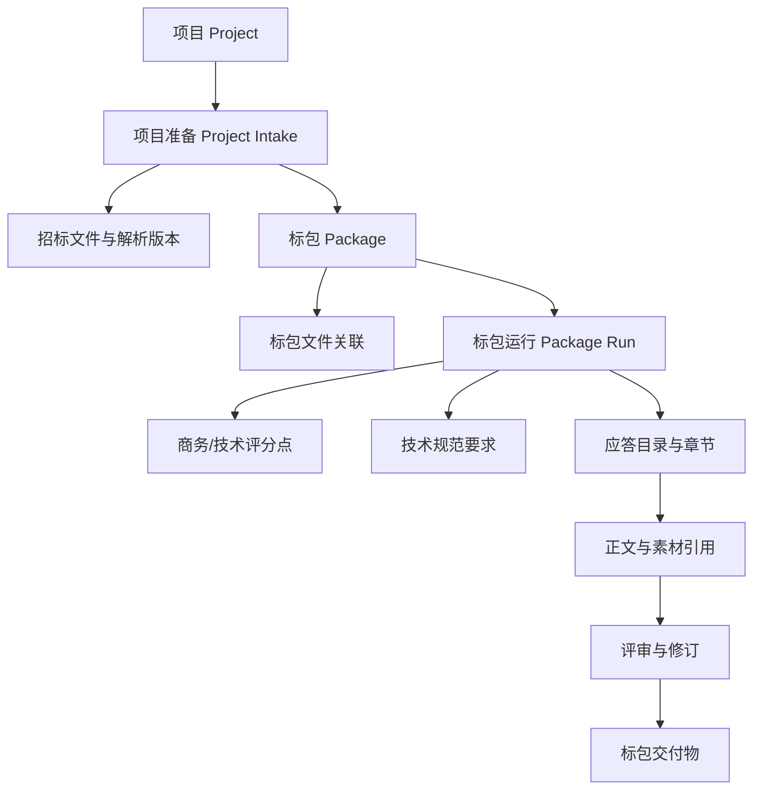
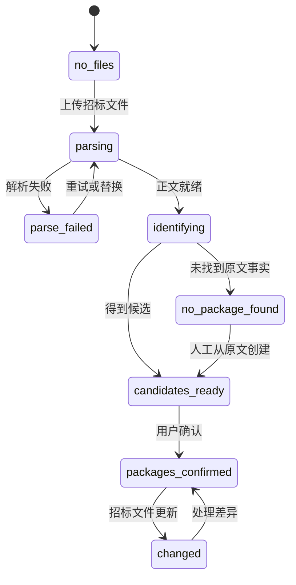

# 方案 A：标包工作空间实施规划

> 日期：2026-10-15  
> 文档性质：产品、交互、数据与工程联合实施规划  
> 本轮范围：只规划，不修改业务代码  
> 目标：把“标包是筛选条件”改造成“标包是五步骤的父级工作空间”

---

# 一、背景与问题定义

## 1.1 当前产品结构

当前主结构仍然是：

```text
项目
→ 直接进入工作台与五步骤
→ 在拆分面板中解析、筛选并确认标包
→ 后续数据部分依赖标包、部分依赖项目或 thread
```

这会产生四个结构性问题：

1. 用户进入后续流程后才确认业务范围，因果顺序倒置。
2. 标包同时承担文件标签、筛选条件、运行范围和本地缓存四种语义。
3. 一个标包的阶段状态可能通过项目级缓存影响另一个标包。
4. 评分点、目录和正文虽然部分带运行归属，但缺少稳定、统一的标包父级。

## 1.2 正确业务链路

```text
项目准备
  → 上传招标文件
  → 文件转正文并建立索引
  → 从原文识别标的 / 标包 / 标段
  → 用户确认投标单元
  → 绑定技术规范书和相关文件
  → 进入当前标包独立的五步骤
      1. 拆分要求
      2. 确认范围与规则
      3. 生成应答结构
      4. 编写与举证
      5. 评审与修订
```

## 1.3 本规划的产品原则

- 没有确认标包，不创建拆分运行。
- 一个运行只能属于一个项目和一个标包。
- 切换标包等于切换评分点、目录、正文、评审、版本和运行状态。
- 文件可以属于多个标包；业务产物不能跨标包共享。
- 招标原文是标包事实来源；模型只能整理和归并有原文证据的候选。
- 重新解析不能静默改写已确认标包，必须产生差异并由用户处理。

---

# 二、目标产品模型

## 2.1 业务对象



| 对象 | 作用域 | 关键规则 |
|---|---|---|
| Project | 项目级 | 保存项目基本信息、共享输入和标包聚合进度 |
| Document | 项目级 | 保存原文件、解析版本、正文和解析质量 |
| Package | 项目下稳定实体 | 保存原文名称、类型、号码、状态和证据 |
| PackageDocument | 项目/标包级 | 文件和标包多对多关系，记录来源和确认方式 |
| PackageRun | 标包级 | 一次拆分、生成和评审版本，只属于一个标包 |
| ReviewPoint | run 级 | 商务、技术、报价评分点及原文依据 |
| SpecRequirement | run 级 | 当前标包的技术规范要求 |
| Chapter | run 级 | 当前标包应答目录和正文 |
| Review | run 级 | 当前标包的评分点与章节评审结果 |

## 2.2 标包身份

不再用 `target + package_no` 字符串组合作为长期身份。新增稳定 `package_id`：

```text
package_id       数据库稳定主键
project_id       所属项目
kind             target / package / section / whole_project
target_code      原文标的编号
package_code     原文标包或标段编号
display_name     原文名称或用户确认名称
status           candidate / confirmed / changed / archived
source_version   识别所依据的招标文件解析版本
```

`target_code/package_code/display_name` 可以修正，`package_id` 不变。所有后续记录引用 `package_id`。

## 2.3 状态机

### 项目准备状态



### 标包工作空间状态

```text
not_started
→ splitting
→ points_review
→ structure_ready
→ writing
→ reviewing
→ revision
→ ready_to_export
→ completed

任意运行中阶段 → failed / paused / aborted
```

阶段状态必须由服务端 `PackageRun` 推导。前端 `sessionStorage/localStorage` 只保存 UI 偏好，不能保存业务阶段真相。

---

# 三、目标信息架构

## 3.1 项目级导航

```text
项目首页
├─ 项目准备
│  ├─ 文件台面
│  ├─ 解析状态
│  ├─ 标包确认
│  └─ 文件归属
├─ 标包工作空间
│  ├─ 标包 1
│  ├─ 标包 2
│  └─ 标包 3
└─ 项目总览（后续）
   ├─ 标包进度
   ├─ 异常与阻断
   └─ 总成本与交付状态
```

## 3.2 项目准备页

项目准备页负责回答三个问题：

1. 招标文件是否已经成功转成可检索正文？
2. 原文中有哪些标的、标包或标段？
3. 每份规范书和辅助文件属于哪些标包？

布局：

```text
┌ 项目名称 ─────────────────────── 准备状态：待确认 2 个标包 ┐
│ ① 上传与解析 ─ ② 确认标包 ─ ③ 关联文件                    │
├────────────────────────────────────────────────────────────┤
│ 文件台面                         标包确认台                 │
│ 招标文件.pdf  正文已就绪          标的1/标包1  高  [确认]   │
│ 规范书A.docx  待归属              标的1/标包2  中  [核对]   │
│ 素材B.docx    可跨标包            标的2/标段1  低  [核对]   │
├────────────────────────────────────────────────────────────┤
│ 已确认投标单元：[标包1 进入工作空间] [标包2 进入工作空间]   │
└────────────────────────────────────────────────────────────┘
```

## 3.3 标包工作空间

页头必须始终显示完整上下文：

```text
项目名称 / 标的 1 · 标包 2 · 高可靠技术专题研究
运行版本 v2 · 招标文件 1 · 技术规范书 2 · [切换标包]
```

主导航只保留一套五步骤：

| 步骤 | 主视图 | 主动作 | 完成条件 |
|---|---|---|---|
| 1 拆分要求 | 商务、技术、报价评分点和规范要求 | 开始/重新拆分 | 结果存在或明确不适用 |
| 2 确认范围与规则 | 评分点、类别、主题归属、分值自检 | 确认规则 | 所有阻断项已处理 |
| 3 生成应答结构 | 目录和映射矩阵 | 生成/确认结构 | 覆盖门槛通过 |
| 4 编写与举证 | 章节正文、引用素材、证据缺口 | 生成/保存/局部修订 | 必填章节完成 |
| 5 评审与修订 | 评分点 verdict、章节明细、缺口 | 评审/针对缺口修订 | 阻断问题关闭或接受风险 |

## 3.4 跨标包切换

“切换标包”使用工作空间切换器，不能继续表现成筛选下拉：

```text
标包                         阶段           未保存   阻断
标的1 / 标包1               编写 12/20      0       2
标的1 / 标包2（当前）       待确认           1       1
标的1 / 标包3               未开始           0       0
```

切换规则：

- 有未保存修改时，要求保存或放弃。
- 切换前预加载目标标包概要；加载失败则留在当前标包。
- 成功后同步替换 URL、run、数据请求和界面状态。
- 目标标包没有运行时显示空状态，不复用上一标包骨架。

---

# 四、数据与后端规划

## 4.1 先决修复

在实施工作空间前必须先修复：

1. `main_rfp/spec` 上传后也要执行正文解析和切片；只有 chunks 落库后才能标记 `done`。
2. 启用或显式实现关联完整性，材料删除不能遗留 chunks 和标包关联。
3. 所有项目级 run 接口校验 `project_id/package_id/thread_id` 归属。
4. 测试 checkpointer 必须使用运行时注入路径，禁止写真实数据库。

## 4.2 数据模型变更

### 新增 packages

| 字段 | 类型 | 说明 |
|---|---|---|
| id | INTEGER PK | 稳定 package_id |
| project_id | INTEGER FK | 所属项目 |
| kind | TEXT | target/package/section/whole_project |
| target_code | TEXT | 标的编号 |
| package_code | TEXT | 标包或标段编号 |
| display_name | TEXT | 原文或用户确认名称 |
| status | TEXT | candidate/confirmed/changed/archived |
| confidence | TEXT | low/medium/high/manual |
| evidence | TEXT JSON | 原句、文件、页码、定位信息 |
| source_version | TEXT | 招标文件解析版本 |
| created_at/updated_at | DATETIME | 审计字段 |

约束：

- 同一项目的活动标包业务键唯一。
- 候选可以重复，确认时必须合并或标记不同。
- 已有运行引用的标包不物理删除，只归档。

### 调整关联表

`material_packages` 改为稳定 ID：

```text
material_id
package_id
source          system / user
confirmed_by
confirmed_at
```

### 调整业务表

以下表增加 `package_id`，并逐步取消仅靠 `package_no` 或 thread 间接归属：

- `workflow_runs`
- `review_points`
- `spec_requirements`
- `blocks`
- `reviews`
- `split_answers`
- `llm_usage`
- 导出/快照记录

保留 `run_thread_id` 用于版本和执行归属；`package_id` 用于业务隔离和查询。

## 4.3 仓储与服务边界

新增或拆分服务：

| 服务 | 职责 |
|---|---|
| PackageRepository | 标包实体、状态、证据和查询 |
| PackageIdentificationService | 从解析正文生成候选并校验证据 |
| PackageDocumentService | 文件—标包关系和确认来源 |
| PackageWorkspaceService | 工作空间概要、活动运行、切换上下文 |
| RunLifecycleService | 创建、恢复、终止和回收标包运行 |

路由层只负责 DTO 和 HTTP 映射，不直接读取 checkpoint 或拼业务 SQL。

## 4.4 API 规划

### 项目准备

| 方法 | 路径 | 用途 |
|---|---|---|
| GET | `/api/projects/{project_id}/intake` | 文件、解析质量、候选标包和阻断摘要 |
| POST | `/api/projects/{project_id}/packages/identify` | 重新从原文识别候选 |
| POST | `/api/projects/{project_id}/packages/{package_id}/confirm` | 确认或修正候选 |
| POST | `/api/projects/{project_id}/packages/merge` | 合并重复候选 |
| POST | `/api/projects/{project_id}/packages/manual` | 从原文人工创建 |
| PUT | `/api/projects/{project_id}/materials/{material_id}/packages` | 设置文件多标包归属 |

### 标包工作空间

| 方法 | 路径 | 用途 |
|---|---|---|
| GET | `/api/projects/{project_id}/packages/{package_id}/workspace` | 工作空间概要和活动运行 |
| POST | `/api/projects/{project_id}/packages/{package_id}/runs` | 创建当前标包运行 |
| GET | `/api/projects/{project_id}/packages/{package_id}/runs/{thread_id}/state` | 获取运行状态 |
| POST | `/api/projects/{project_id}/packages/{package_id}/runs/{thread_id}/actions/{action}` | 执行阶段动作 |
| GET | `/api/projects/{project_id}/packages/{package_id}/points` | 当前版本评分点 |
| GET | `/api/projects/{project_id}/packages/{package_id}/chapters` | 当前版本目录和正文 |
| GET | `/api/projects/{project_id}/packages/{package_id}/reviews` | 当前版本评审 |

所有嵌套路由必须验证实体归属；不匹配返回 404 或 409，不能静默回退到“最新运行”。

## 4.5 幂等与并发

- 标包识别使用 `source_version + content_hash` 保证相同输入不重复生成候选。
- 创建 run 接受 `Idempotency-Key`，重复点击返回同一活动运行。
- 同一标包同一时间只允许一个改变结构的运行；只读和局部保存可并行。
- 文件更新、标包确认、评分点拆分均记录 revision。
- 切换标包不终止后台运行，但用户回到该标包时能恢复进度。

---

# 五、前端实施规划

## 5.1 页面与路由

建议目标 URL：

```text
/projects/{projectId}/intake
/projects/{projectId}/packages/{packageId}?step=points
/projects/{projectId}/packages/{packageId}?step=confirm
/projects/{projectId}/packages/{packageId}?step=structure
/projects/{projectId}/packages/{packageId}?step=writing
/projects/{projectId}/packages/{packageId}?step=review
```

如暂时保留 `/three-mode`，也必须要求 `packageId`：

```text
/three-mode?projectId=26&packageId=8&threadId=...&view=outline
```

缺 packageId 时跳到项目准备页，不允许猜测最近标包。

## 5.2 模块拆分

将当前巨型模块按页面生命周期拆分：

```text
frontend/assets/intake/
  intake-page.js
  document-desk.js
  package-confirmation.js
  package-document-binding.js

frontend/assets/workspace/
  workspace-shell.js
  package-switcher.js
  points-step.js
  confirmation-step.js
  structure-step.js
  writing-step.js
  review-step.js
  workspace-store.js
```

每个步骤只在进入时 `mount()`，离开时 `unmount()`；隐藏模式不能继续请求、轮询或监听快捷键。

## 5.3 前端状态

单一工作区状态：

```javascript
{
  projectId,
  packageId,
  threadId,
  runVersion,
  currentStep,
  serverStage,
  dirtyResources,
  blockers
}
```

- 服务端是业务状态真相。
- URL 是当前工作区和步骤的可分享定位。
- sessionStorage 只保存未提交草稿引用，不保存最远阶段。
- localStorage 只保存折叠、栏宽等展示偏好。

## 5.4 错误处理

统一 API client：

- 所有非 2xx 抛出结构化错误。
- 切换、确认、重跑等关键动作使用请求状态防重复点击。
- reset、abort、创建 run 等前置动作失败时禁止继续下一动作。
- 页面错误必须区分文件解析失败、未发现标包、候选待确认、文件未归属、运行失败和网络失败。

---

# 六、迁移策略

## 6.1 渐进迁移原则

采用“扩展 → 回填 → 双读验证 → 切换 → 删除旧路径”，避免一次性重写。

### 阶段 1：扩展

- 新建 `packages` 和稳定关联表。
- 为业务表增加可空 `package_id`。
- 新接口写入 package_id，旧字段暂时保留。

### 阶段 2：回填

- 从 `project_packages` 生成 packages。
- 通过 `target/package_no` 回填 workflow_runs。
- 通过 run 回填评分点、技术要求、blocks、reviews。
- 无法唯一归属的数据标记 `needs_manual_assignment`，不自动猜测。

### 阶段 3：双读验证

- 新旧查询同时执行，只返回新结果。
- 记录数量、业务键和标包归属差异。
- 差异为零或经过人工确认后进入下一阶段。

### 阶段 4：切换

- 前端只调用 package workspace API。
- 禁止创建没有 package_id 的新运行。
- 旧 URL 服务端重定向到项目准备页或对应标包。

### 阶段 5：收尾

- 删除旧上传 API、项目级范围猜测和错误的最新运行回退。
- 清理旧页面完整业务副本。
- package_no 降级为展示/兼容字段。

## 6.2 历史数据处理

| 情况 | 处理 |
|---|---|
| run 有 target/package_no | 自动关联或创建候选 package，标记待确认 |
| run 没有范围但 checkpoint 有 scope | 从 checkpoint 回填，记录来源 |
| 多个 package 可能匹配 | 不自动回填，进入人工归属清单 |
| blocks/reviews 无有效 run | 归档为孤儿数据，不进入新工作空间 |
| 已删除项目或运行的 usage | 进入历史清理策略，不映射到活动标包 |
| 招标文件无显式标包 | 用户确认后创建 `whole_project` 投标单元 |

---

# 七、分期实施计划

## Phase 0：先决缺陷修复

**目标：确保标包识别有可靠正文输入，测试不会污染真实库。**

任务：

- 要求类文件统一进入解析和切片管线。
- 修复材料删除的关联清理和外键策略。
- 修复 checkpointer 路径注入。
- 前端 API 统一检查非 2xx。
- 增加“真实上传→正文 chunks→标包识别”集成测试。

退出条件：真实文件上传后可稳定得到正文和标包候选；测试前后真实库 hash 不变。

## Phase 1：标包聚合根与强门控

**目标：没有 confirmed package 就不能启动五步骤。**

任务：

- 增加 packages、package_id 和迁移脚本。
- 实现标包候选、确认、合并、人工创建。
- 建立项目准备聚合接口。
- 创建 run 前验证项目、标包和文件准备度。
- 禁止跨项目或跨标包 thread 写入。

退出条件：任意后端调用都不能绕过标包确认创建评分点运行。

## Phase 2：项目准备页

**目标：完成上传、解析、标包确认和文件归属闭环。**

任务：

- 将当前文件台面迁移到项目准备页。
- 显示文件的上传、正文解析、索引、标包识别状态。
- 实现标包确认卡及原文证据查看。
- 实现技术规范书和素材的多标包归属。
- 处理未找到、低置信度、重复候选和招标文件更新差异。

退出条件：用户能在不进入五步骤的情况下完成全部准备工作。

## Phase 3：标包工作空间壳与五步骤迁移

**目标：五步骤全部以 package_id 为根。**

任务：

- 新建工作空间路由、页头和标包切换器。
- 统一项目级四阶段与五步骤，删除重复进度表达。
- 将拆分、确认、结构、编写、评审依次迁入工作空间。
- 将请求、缓存和 SSE 订阅绑定到 packageId/threadId。
- 步骤模块按需加载并支持 mount/unmount。

退出条件：标包 A 和 B 可分别处于不同阶段，切换无数据残留。

## Phase 4：版本、差异和历史迁移

**目标：招标文件更新和重新拆分不会破坏既有工作。**

任务：

- 完成历史 package_id 回填和人工归属工具。
- 招标文件更新生成标包差异。
- 标包重新拆分创建新 run version，旧版本只读。
- 增加版本对比和回退入口。
- 清理孤儿 revisions/reviews 和失效 checkpoint。

退出条件：更新招标文件后，旧工作区仍可追溯，新范围需显式确认。

## Phase 5：旧路径下线与项目总览

**目标：消除重复实现，形成稳定产品入口。**

任务：

- 旧 `/project-init`、`/workbench` 改服务端重定向。
- 下线无人调用的旧 `/api/upload` 管线。
- 删除旧页面完整业务副本和错误路由契约测试。
- 增加项目级标包进度矩阵、异常和成本总览。

退出条件：生产只有项目准备页和标包工作空间两类主入口。

---

# 八、测试与验收计划

## 8.1 后端测试矩阵

| 场景 | 预期 |
|---|---|
| 上传含 3 个标包的招标文件 | 产生 3 个带原文证据的候选 |
| 招标文件无标包表述 | 返回无候选，不虚构；允许人工创建 |
| 规范书关联两个标包 | 两个工作空间可读取，产物各自落库 |
| 未确认标包创建 run | 409，且数据库没有新 run |
| 项目 A + 项目 B thread | 404/409，不产生跨项目写入 |
| 标包 A thread 写标包 B | 404/409，不产生跨包写入 |
| 同一创建请求重复提交 | 返回同一活动 run |
| 删除材料 | chunks 和关联一并删除，无孤儿 |
| 重新解析招标文件 | 返回标包差异，不覆盖 confirmed package |
| 运行测试套件 | 真实数据库 hash、mtime、行数不变 |

## 8.2 前端测试矩阵

- 项目准备页四种状态：无文件、解析中、待确认、准备完成。
- 未确认标包时不渲染可执行五步骤。
- 标包 A/B 各自保存不同步骤和内容。
- 切换失败保留原工作区。
- 隐藏步骤不发业务请求、不监听快捷键。
- 非 2xx 不清本地状态、不启动下一动作。
- URL 刷新恢复同一 package/run/step。
- 浏览器 smoke 验证 `__bootErrors=[]`。

## 8.3 产品验收门槛

1. 用户进入新项目后首先看到项目准备，而不是五步骤。
2. 所有标包候选都有可核对的招标原文证据。
3. 未确认投标单元前不能拆评分点。
4. 标包 A 的商务/技术评分点不出现在标包 B。
5. 标包 A 的目录、正文和评审不会推进标包 B 的阶段。
6. 切换到未开始标包时显示空状态，不残留上一标包数字或列表。
7. 招标文件更新后不静默覆盖既有工作。
8. 导出文件、LLM 用量和审计记录能够追溯到 package/run/version。

---

# 九、风险与控制

| 风险 | 影响 | 控制措施 |
|---|---|---|
| 历史数据无法唯一归属 | 迁移错包 | 不猜测，进入人工归属队列 |
| 新旧路径双写 | 数据分叉 | 新接口成为唯一写路径，旧接口只读兼容 |
| 巨型前端模块继续共享状态 | 切包残留 | 按步骤 mount/unmount，移除项目级阶段缓存 |
| 招标文件重新解析改变标包 | 已有内容失效 | 差异确认、旧版本只读、显式迁移 |
| 多标包并行增加后台任务 | 资源竞争 | 每标包单写锁、项目级并发限额、队列化 |
| LLM 整理生成无依据名称 | 业务事实失真 | 无原文证据的候选一律丢弃 |
| 一次性大迁移 | 回归面过大 | 扩展、回填、双读、切换、删除五阶段迁移 |

---

# 十、范围边界

## 本期包含

- 项目准备页。
- 标包稳定实体和文件归属。
- 标包工作空间与五步骤迁移。
- 数据隔离、历史迁移、版本与差异。
- 旧入口与重复路径下线。

## 本期不包含

- 多人实时协作与权限体系。
- 企业级跨项目素材库重构。
- 新的 PDF 导出和电子签章。
- 自动批量跑全部标包。
- 用模型替代人工确认低置信度标包。

这些能力可以建立在稳定 package workspace 上，但不应阻塞本次主结构修正。

---

# 十一、交付物清单

| 类型 | 交付物 |
|---|---|
| 产品 | 项目准备页、标包确认、工作空间五步骤、切换与异常规范 |
| 数据 | packages、package_id 关联、迁移记录和孤儿清理报告 |
| 后端 | intake/package/workspace API、归属校验、幂等与并发控制 |
| 前端 | intake 模块、workspace shell、步骤模块、统一 API client |
| 测试 | 上传集成、跨包隔离、迁移、浏览器 smoke、真实库防污染 |
| 运维 | 数据迁移脚本、回滚开关、运行保留策略和 readiness 检查 |

---

# 十二、完成定义

方案 A 完成需要同时满足：

1. 产品入口符合“项目准备 → 标包 → 五步骤”。
2. 服务端无法创建无 package_id 的新运行。
3. 评分点、技术要求、目录、正文、评审全部可按 package_id 精确查询。
4. 两个标包并行推进时数据和阶段完全隔离。
5. 历史数据已迁移或明确进入人工处理/归档状态。
6. 旧页面和旧上传写路径已经下线。
7. 真实上传、跨包隔离、招标文件更新和浏览器启动测试全部通过。
8. 生产数据库没有新增孤儿关联，测试不会修改真实数据库。

达到以上条件后，标包才真正从“筛选器”升级为产品的核心作业单元。
