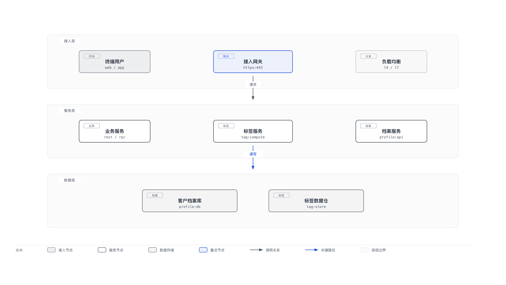
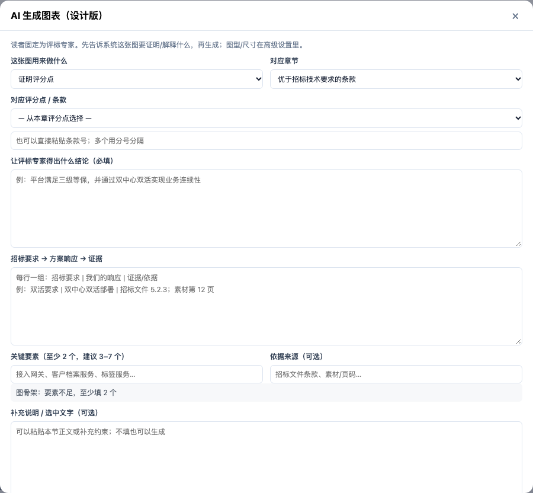
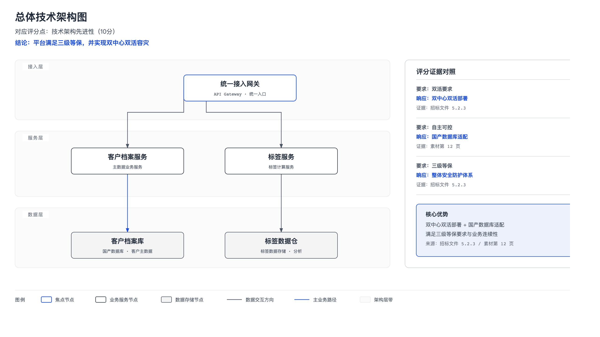
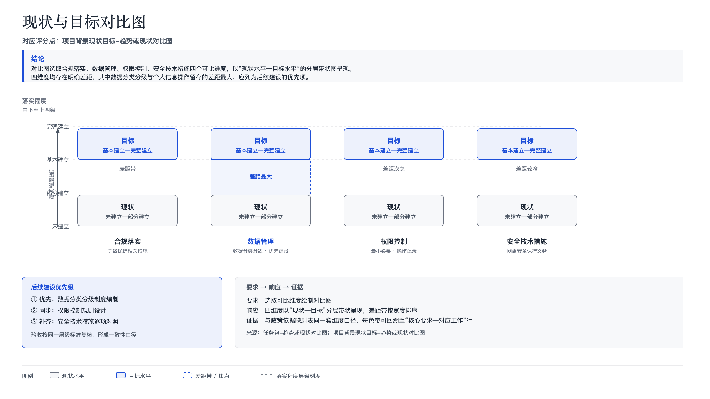

# 设计版生图：输入与场景适配核查

> 日期：2026-11-03
> 范围：`frontend/assets/chapter-studio.mjs` 的设计版弹窗、`backend/services/diagram_design.py` 的 brief/提示词、`backend/skills/diagram_design/` 的 vendored 技能与样式。
> 结论：**问题不只在“提示词怎么写”，而是输入模型、章节绑定、场景视觉规范、技能资源四层都不匹配。** 只改 prompt 文案解决不了“线框图”和“用户不会写”的问题。

## 核心约束（用户确认）

**项目里所有设计版图只有一个读者：评标专家。**

不是给领导看的“方案汇报图”，也不是给技术团队看的“架构说明图”，而是**评分表上的证据图**。这直接决定：

- 图的目标不是“好看”，而是让评标专家在 10 秒内看出：**对应哪条评分点 / 我们怎么响应 / 证据是什么 / 比要求多做了什么**；
- 图必须能单独成立：专家不看正文，也能从图+图注读出结论；
- 不使用“给谁看”这种字段——读者固定是评标专家；
- 不用装饰性图标、口号、渐变；用正式、保守、可打印的视觉；
- 图上的每个数字/承诺都必须有正文或依据支撑。

## 评分点绑定：要不要框死

**结论：不要“每张图必须绑一个评分点”，但每张图必须有明确的论证任务；评分证据类图必须绑定，理解辅助类图允许不绑定。**

原因是评标专家虽然看所有内容，但图的论证任务不同：

| 图类型 | 例子 | 是否绑定评分点 | 说明 |
|---|---|---|---|
| 评分证据图 | 技术架构响应、部署/安全、实施计划、现状-目标对比 | **必须绑** | 图就是某一评分点的证据，必须能回答“对应哪条、怎么响应、证据在哪” |
| 理解辅助图 | 项目现状、业务背景、组织分工、数据流 | **弱绑定/可不绑** | 帮专家建立理解，支撑“对项目的理解/方案完整性”，但强行对应唯一评分点会扭曲图 |
| 合规/客观分内容 | 资质、条款逐条响应、人员证书 | **不用图** | 应该用表格/矩阵，不硬画架构图 |
| 跨评分点总览 | 总体架构、总体实施路径 | **可一对多** | 一张图支撑多个评分点，不能强迫拆成多张 |

硬绑定的代价：

- 图会被迫长成“评分表”，失去架构/流程本身的可读性；
- 评分点粒度粗时，一张图对应多条，粒度细时又多张图重复；
- 用户为了填评分点，容易“为评分而评分”，产生无证据的图；
- 评分表调整时，图要大改。

**更好的模型：purpose-first，score-conditional。**

1. 先问“这张图用来做什么”：
   - 证明某条评分点 → `score_evidence`
   - 解释方案/现状 → `explain`
   - 对比/选择 → `compare`
2. `score_item` 只在 `score_evidence` / `compare` 时必填；`explain` 允许只绑章节/问题。
3. 所有图都必须填“让评标专家得出什么结论”和“依据来源”。
4. 质量门按 purpose 分流：
   - `score_evidence`：评分点 + 要求-响应-证据 缺失 → 不允许生成；
   - `explain`：结论 + 章节 + 关键要素 缺失 → 不允许生成；
   - 任何图：没有结论/依据 → 不允许生成。

## 0. 当前实际体验

当前输入弹窗（从「优于招标技术要求的条款」章节进入）：


当前生成结果（架构图，3 层 / 9 个节点）：



看到的问题：

1. **图名直接用了章节标题**（“优于招标技术要求的条款”），不是图名。
2. **内容来源只有一行标题**：本章没有 points 时，`gist` 退化成 `active.title`，用户只能自己猜要写什么。
3. **图型列表是“视觉类型”**（架构图/分层图/金字塔/矩阵图），不是用户脑子里的“我要放在技术方案里的哪一段”。
4. **尺寸列表是排版术语**（文档宽/A4/16:9），用户不知道选哪个。
5. **输出是“结构正确但视觉空”的线框**：白底/浅灰卡片、框+箭头+图例，没有图标、没有业务注释、没有层带信息密度，放在投标正文里像示意图草稿。
6. 用户没有任何“好输入”的参照：没有示例、没有必填项、没有信息不足提示。

---

## 1. 输入层：用户不知道写什么

### 1.1 代码事实

`openDesignDiagramDialog()`：

- `gist` 的逻辑是：
  - 有选中文字 → 用选中文字；
  - 没有 → `active.title` + 整章 outline 的标题/points。
- 当本章/本节没有 points 时，实际只剩一行章节标题。
- 弹窗只校验 `if (!text)`，**一行标题也能生成**。
- `section: ''` 永远不传，后端不知道这张图属于哪一节。
- `elements` / `evidence` / `caption` 后端支持，但前端完全不传。
- 图型默认被 `presetType='architecture'` 钉死；后端 `recommended` 只改了提示文案，没有改选中项（`!presetType` 永远为 false）。

### 1.2 根因

不是“用户不会写提示词”，而是**产品把提示词的负担丢给了用户**：

- 用户要自己决定：图型、尺寸、内容范围、要素、关系、受众、风格；
- 系统没有从章节/素材里自动抽取“图应该表达什么”；
- 输入框是一个没有结构的 textarea；
- 没有“信息够不够”的判断。

### 1.3 建议：把“写提示词”改成“填图卡”

不要问“内容来源”，改成 3 步：

**第 1 步：选场景（不是选图型）**

| 评分场景 | 默认图型 | 评标专家要看到什么 |
|---|---|---|
| 技术架构响应 | architecture | 招标要求的层/模块，我们如何覆盖 |
| 分层技术栈 | layers | 从接入到数据的完整技术栈，自主可控在哪 |
| 评分点覆盖矩阵 | quadrant/table | 每条评分点由哪项能力响应、证据在哪 |
| 实施计划/里程碑 | timeline/process | 阶段、交付物、时间承诺是否可落地 |
| 部署与安全边界 | architecture | 部署位置、边界、容灾/安全措施 |
| 现状 vs 目标 | architecture-delta | 改造前问题、改造后收益、差异证据 |
| 自主可控/国产化适配 | architecture/layers | 哪些组件国产化、适配哪些版本 |
| 运维保障/服务响应 | process/loop | 服务流程、SLA、响应机制 |
| 组织与职责 | org-chart | 谁负责、怎么协同、职责边界 |

视觉类型/尺寸收进「高级设置」。

**第 2 步：先选图的用途，再按用途填字段**

用途（单选）：

- **证明评分点**（score_evidence）：这张图是某条评分点的证据；
- **解释方案/现状**（explain）：帮助专家理解项目、现状或方案；
- **对比/选择**（compare）：改造前后、方案 A/B、现状-目标。

字段：

1. **这张图要让评标专家得出什么结论**（所有用途必填，一句话，≥10 字）
2. **对应评分点/条款**（`score_evidence` / `compare` 必填；`explain` 可选）
3. **招标要求 → 方案响应 → 证据**（仅 `score_evidence` 必填，3–7 组）
4. **图中必须出现的要素/证据/数字**（所有用途必填，3–7 个；数字必须带来源）
5. **对应章节/问题**（`explain` 必填；用于绑定正文语境）

选填：

- 图中不能出现什么（避免无关模块、未承诺内容）
- 图注/图号（默认自动生成“图 3-2 …”）
- 输出格式（Word 正文 / 黑白打印 / 汇报投屏）

**第 3 步：生成前先看“骨架”**

- 列出即将画的节点（3–7 个）和关系；
- 用户可拖动/删除/改名；
- 确认后才调用模型。

这样用户不需要会写 prompt，只需要确认“图里有什么”。

**评标专家图的固定表达规则：**

1. 图注第一行必须带评分点/条款编号；
2. 图内至少 1 条“结论标注”（如“满足并优于：双活+异地备份”）；
3. 关键模块旁边标“响应/证据”（如“国产数据库适配：达梦 V8”）；
4. 不使用装饰图标/口号；颜色只用黑/灰/品牌蓝；
5. 字号按打印可读，最小 10px（A4 横向）；黑白打印仍能区分层级；
6. 不在图里写无法核验的数字；数字必须能在正文/依据中找到。

---

## 2. 章节绑定：图的内容来源太薄

### 2.1 代码事实

- 手工入口：`section` 为空，`text` 是整章 outline，不是当前节正文。
- 自动入口：`section_brief()` 只拼 `section.title + points + basis.ref`，**不读本节正文、不读素材摘录**。
- 两个入口都不带 `evidence` 的实际内容（只有 ref 名称）。
- 图名用章节标题，不带“图 x-x”编号。

### 2.2 后果

- 模型只能从几个标题词里猜内容，输出空泛的“接入层/服务层/数据层”；
- 自动批量生成的图与本节正文脱节；
- 评标专家看到的图不能支撑正文论点。

### 2.3 建议

- 手工入口：默认取**当前小节正文 + 本节 points + 已确认素材摘录**，显示“已使用：正文 420 字 / 3 条依据”，允许取消。
- 自动入口：`section_brief` 读取本节正文（截断）、已绑定素材 chunk、依据 ref，而不是只读计划 points。
- 图名默认：`图 {章节号} {图意}`，例如「图 3-2 总体技术架构」。
- 后端 brief schema 增加：
  ```json
  {
    "scene": "architecture",
    "intent": "说明平台由接入、服务、数据三层组成",
    "elements": ["统一接入网关", "客户档案服务", "标签服务", "客户档案库"],
    "relations": "layered",
    "audience": "bid_expert",
    "style": "bid_deck",
    "forbidden": ["不要画未在正文出现的中间件"],
    "section": "3.2 总体技术架构",
    "source_refs": ["..."]
  }
  ```

---

## 3. 视觉层：为什么像线框图

### 3.1 代码事实

- `style-guide.product.md` 的 node treatment：
  - `backend` 白底；
  - `store` 5% 墨；
  - `external` 3% 墨；
  - accent 只允许 1–2 个焦点。
- 类型参考 `type-architecture.md`：zone fill 只有 `ink @ 0.02`，节点基本白底。
- 提示词没有“图标/注释/层带/信息密度”的最低要求。
- 我们 vendored 的 `prompt-core.product.md` 还引用了 **7 个不存在的文件**：
  - `primitive-icons.md`
  - `primitive-annotation.md`
  - `primitive-sketchy.md`
  - `primitive-terminal.md`
  - `onboarding.md`
  - `export.md`
  - `assets/icons.html`
- 模型看到“可选图标/注释”的说明，但拿不到规范，结果就是只画框。

### 3.2 根因

上游 Diagram Design 的默认审美是 **editorial minimal**：白纸、细线、少色、强留白，适合设计文档/官网，不适合中文投标技术方案的“信息密度 + 权威感 + 业务语义”。

我们直接沿用了它的默认 skin，只把 accent 换成品牌蓝，没有做“投标方案图”的视觉 profile。

### 3.3 建议：新增「评标正式版」视觉 profile

不是把图做成花哨 PPT，而是让图有**评标可读性 + 响应证据**：

- 3–4 条横向**层带**（业务/应用/数据/基础设施），浅灰底 + 左侧层名标签；
- 组件卡片：白底 + 细边，顶部 2–3px 品牌蓝/灰条；核心 1–2 个用蓝底/蓝边；
- 每个节点有中文名 + 9–10px 技术标签/职责说明，不是空框；
- 关键节点配简单几何图标（网关/服务/数据库/用户/云），SVG 内联，不依赖外网；
- 1–2 个右侧/底部**结论/证据注释框**，写“满足哪条要求、证据是什么”；
- 主路径品牌蓝 2px，辅助灰 1px，标签白底；
- 图例放底部，标题/图号放顶部；
- 留白控制在 10–15%，不是 40%。

保留一个「极简线框」风格给需要黑白打印的章节；默认用「评标正式版」。

**同时补齐资源**：
- vendor `primitive-icons.md`、`primitive-annotation.md` 和 `assets/icons.html`（或删掉 prompt 里的死链接）；
- 新建 `style-guide.bid.md` / `prompt-core.bid.md`，不要直接改上游默认 profile；
- 给 `prompt-core` 加一条最低视觉要求：
  - 至少 2 种 node treatment；
  - 至少 1 个 zone/band；
  - 至少 1 个注释或图例；
  - 不允许所有节点都是同一种白底框。

---

## 4. 其他嵌入问题

| 问题 | 证据 | 影响 |
|---|---|---|
| 推荐图型不生效 | `presetType` 恒为 `architecture`，`fillTypes` 的推荐逻辑被 `!presetType` 挡住 | “推荐”是假推荐，始终架构图 |
| 图名/章节标题混用 | `value="${active.title}"` | 图名像章节名，Word 图注不对 |
| 尺寸术语 | 文档宽/A4/16:9 | 用户不知道选哪个 |
| 自动/手工 brief 不一致 | 自动有 `elements/evidence/strict`，手工都没有 | 同一功能两种质量 |
| 严格数字只对自动生效 | 手工只提示 | 手工图仍可能带编造数字 |
| 缺图标/注释规范 | prompt 引用不存在文件 | 模型只能画框 |
| 没有“信息不足”判断 | 一行标题也能生成 | 输出空泛图 |
| 没有示例 | 弹窗无任何示例 | 新用户无法学习 |

---

## 5. 建议的落地顺序

### P0：先解决“不会写”和“像线框”
1. 输入改成「用途 + 结论 + 要素/证据 + 骨架预览」，评分点按用途条件必填；
2. 默认从当前节正文/素材取内容，显示来源；
3. 新增「评标正式版」视觉 profile（层带/卡片/结论注释/证据标注）；
4. 修复推荐图型和图名；
5. 输入不足时阻止生成，给示例。

### P1：自动批量对齐
- 自动 `section_brief` 用同一套结构化 brief；
- 手工/自动共用质量门（数字/要素/几何）；
- 图名带章节号；
- 支持“图骨架”编辑后再生成。

### P2：资源与评估
- 补齐 icons/annotation 资源，删除死链接；
- 3 个真实章节 A/B：线框 vs 评标正式版；
- 给评标专家看 5 张图，记录“是否支撑正文/是否像正式方案”。

---

## 6. 验收标准

- 用户不写 prompt，只选场景 + 填 4 个字段即可生成；
- 输入只有标题时明确提示“信息不足”，不生成；
- 生成图至少有：3 个层/区、2 种节点样式、1 个注释、1 个图例、0 个空框；
- 图中节点 80% 以上能在本节正文/素材找到依据；
- 每张图图注都有评分点/条款编号；
- 同一 brief 手工生成与自动生成的结构一致；
- 评标专家盲测：优先选“评标正式版”而不是“线框”的比例 ≥ 70%；且能指出图对应的评分点。

## 7. 本轮已落地的 P0 改动

用户确认“所有内容给评标专家看、但不框死评分点”后，已先落地一版最小闭环：

- 输入弹窗改为 **用途（证明评分点 / 解释 / 对比）+ 对应章节 + 评分点（条件必填）+ 结论 + 要求→响应→证据 + 关键要素 + 依据**；图型/尺寸收进高级设置。
- 后端 brief 增加 `purpose / claim / score_refs / mapping / source_refs`；评分证据类缺评分点直接 422。
- skill 提示词增加「评标正式版」固定约束：顶部标题/评分点/结论三行、层带语义、证据区不得占用层带、安全边距、可打印字号。
- 生成校验增加 `score_visible / claim_visible`；自动生成严格模式下缺失会回退；手工只提示。
- 自动 `section_brief` 开始读取本节正文（Markdown 标题下正文），不再只读 points/basis。
- 新输入弹窗：



- 同一 brief 的新输出（评分点/结论/证据区/层带已出现）：



仍待解决：
- 视觉仍偏“结构图”，图标/业务语义密度还不够；需要下一轮专门的评标正式版视觉 profile。
- 评分点选择器已接本章 plan basis，但 plan 无评分点时仍需手填；
- 图骨架只读；节点/关系编辑未做。
- 自动批量与手工共用同一套视觉规则，还需要真实章节 A/B。

## 8. 真实章节试跑

用真实章节 41828「现状与目标对比图」的 plan（评分点/要点/依据）+ 本节正文生成了评标图：



结果：
- 评标点/结论/图例/要求→响应→证据都出现；
- 层带与卡片语义正确；
- `elements` 从已有 `:::diagram` 节点抽取（合规落实/数据管理/权限控制/安全技术措施），不再只读 points；
- `score_visible/claim_visible=true`；
- 几何无越界/重叠；连线穿字检测对轴线标签有误报，已在 UI 中隐藏该项（仍保留在 checks 调试）。
- 图名还没有接严格章节号；真实文档中需由前端图号字段拼接。
