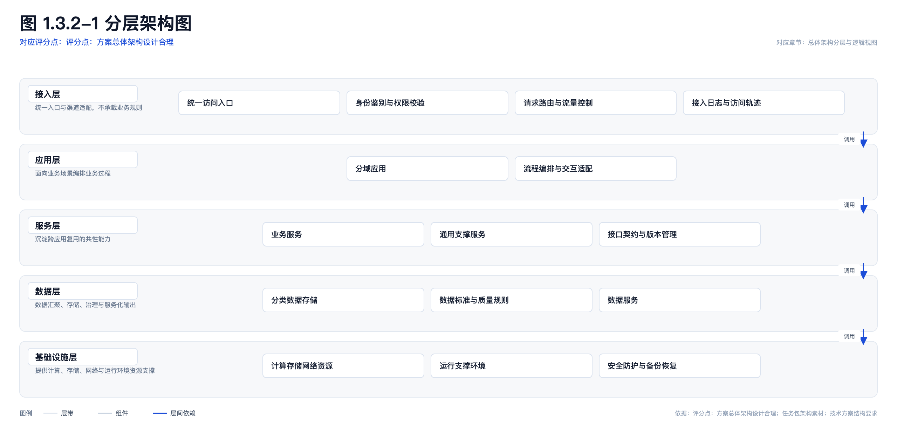
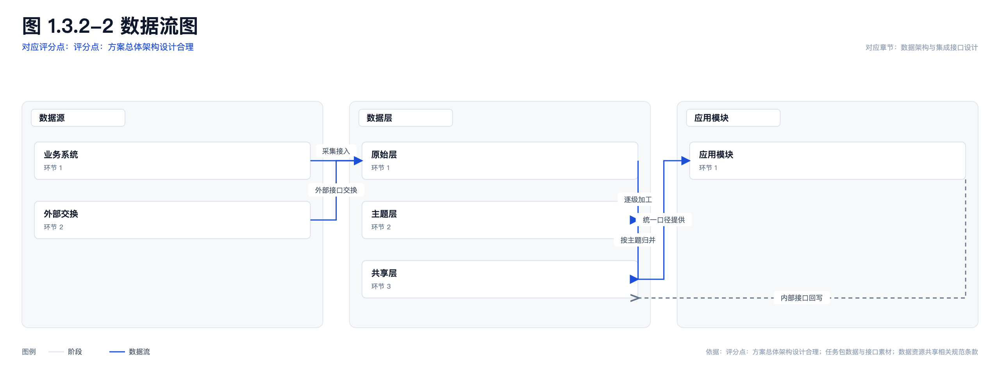
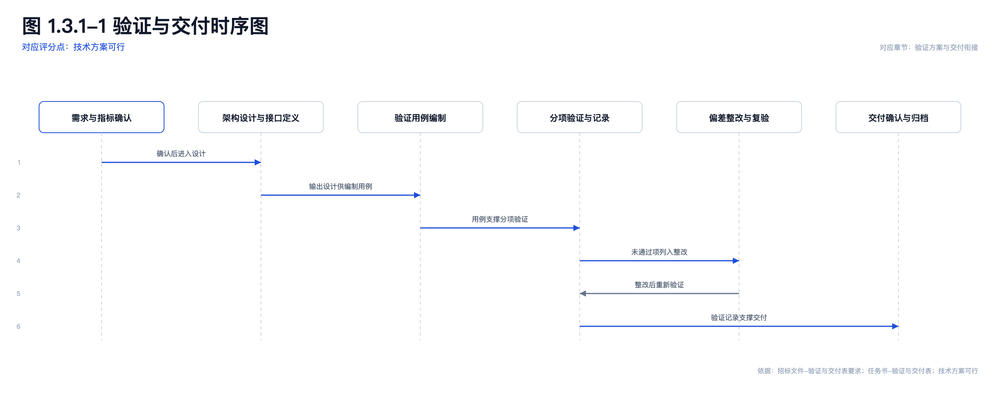
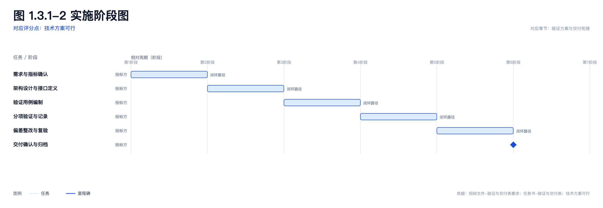
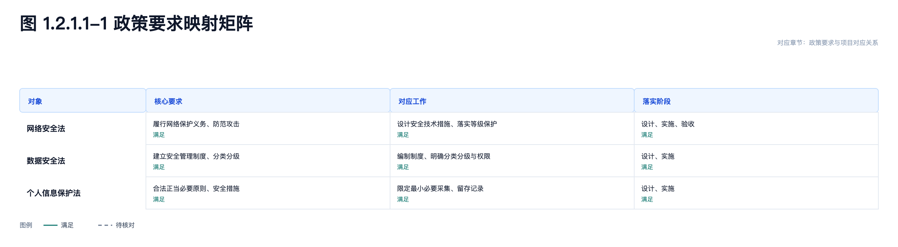
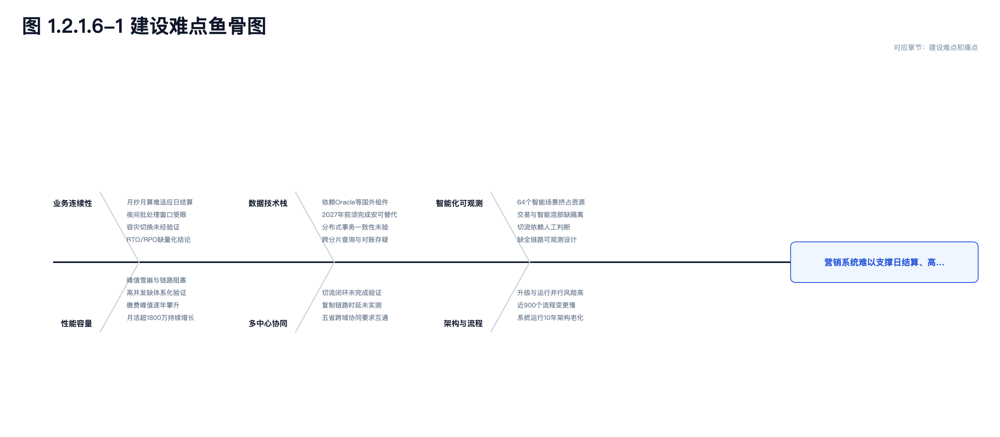
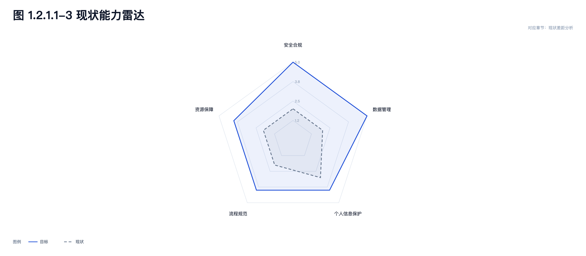
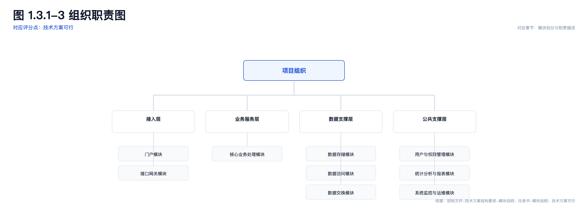

# 生产级图模板：9 类真实例子

> 数据来源：本地真实项目 29 的章节正文/计划。
> 生成方式：LLM 从正文抽取结构化事实 → 模板代码确定性渲染；不是模型直接画 SVG。
> 说明：甘特/组织两类的源章节不是原生“实施计划/组织”章节，结构是从真实正文推断，正式使用前需人工核对任务/角色。

| 模板 | 图 | 真实来源 |
|---|---|---|
| 分层架构图 |  | 1.3.2 总体架构分层与逻辑视图 |
| 数据流图 |  | 1.3.2 数据架构与集成接口设计 |
| 时序图 |  | 1.3.1 验证方案与交付衔接 |
| 甘特/阶段图 |  | 1.3.1 验证方案与交付衔接 |
| 矩阵对照图 |  | 1.2.1.1 政策要求与项目对应关系 |
| 鱼骨图 |  | 1.2.1.6 建设难点和痛点 |
| 金字塔/目标分层 |  | 1.2.1.1 项目目标体系 |
| 能力雷达 |  | 1.2.1.1 现状差距分析 |
| 组织/职责图 |  | 1.3.1 模块划分与职责描述 |

## 共同特征

- 图号 + 结论；评分点仅在明确关联时显示；
- 依据来源；
- 统一白底、品牌蓝、灰阶；
- 模板负责布局，LLM 只抽事实；
- 同一输入可稳定复现。

## 说明：评分点不是必含元素

图例元素（层带、节点、数据流、任务等）和评分点不一定有对应关系。
- 模板不再把“评分点”列为必含元素；
- 前端“关联评分点/条款”默认空、不再自动带出；
- 只有用户明确填写时，图头才显示“对应评分点”；
- 图例只负责解释图形元素，不承担评分点映射。

## 当前不足

- 甘特/组织需要更结构化的输入（阶段/日期/角色），否则只能从正文推断；
- 数据流/鱼骨图的连线标签和分支布局还需要按真实章节继续打磨；
- 部署拓扑（另一套模板）未列入本页；
- 复杂图仍建议在生成后由方案经理微调。

## 模板元素核对

| 模板 | 必须元素 | 当前结果 |
|---|---|---|
| 分层架构图 | 图号/结论、层带、层内组件、**层间箭头**、图例、依据 | ✅ 已补层间调用箭头和图例 |
| 数据流图 | 阶段列、节点、**有向数据流+关系标签**、图例、依据 | ✅ 已补方向路由、回流线、图例 |
| 时序图 | 参与角色、生命线、**消息顺序号**、请求/响应、结论 | ✅ 已补消息序号 |
| 甘特/阶段图 | **时间轴**、任务、起止时间、负责人、里程碑、依据 | ✅ 有日期时显示日历轴；无日期时显示“第N阶段/相对周期” |
| 矩阵对照图 | 行头、列头、单元格、状态、图例、结论 | ✅ 已补状态图例 |
| 鱼骨图 | 结果/问题、原因类、原因、主骨/分支、结论 | ✅ 已修正结果框文字截断 |
| 金字塔/目标分层 | 层级、层级编号、支撑要素、结论 | ✅ 已补 L1/L2 层级号 |
| 能力雷达 | 维度轴、现状/目标多边形、量程、图例 | ✅ 当前虚线/目标实线，补量程与图例 |
| 组织/职责图 | 根节点、下级组、汇报总线、角色说明、依据 | ✅ 已补组织总线 |
