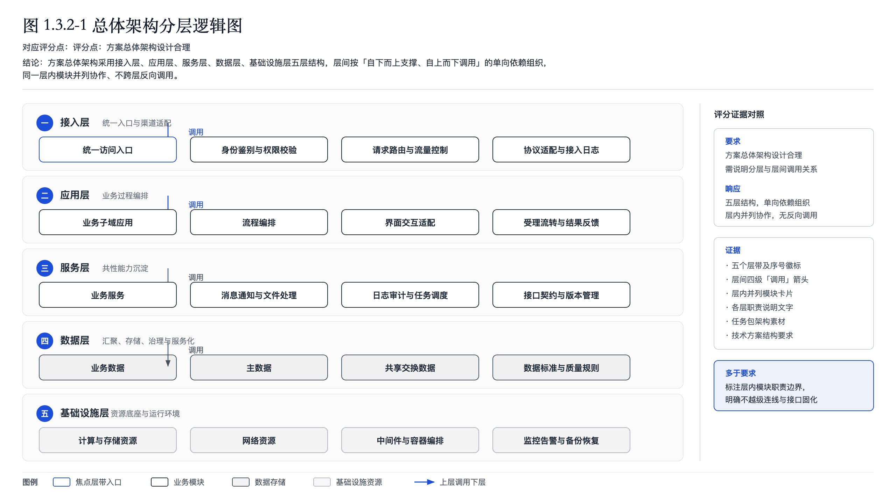
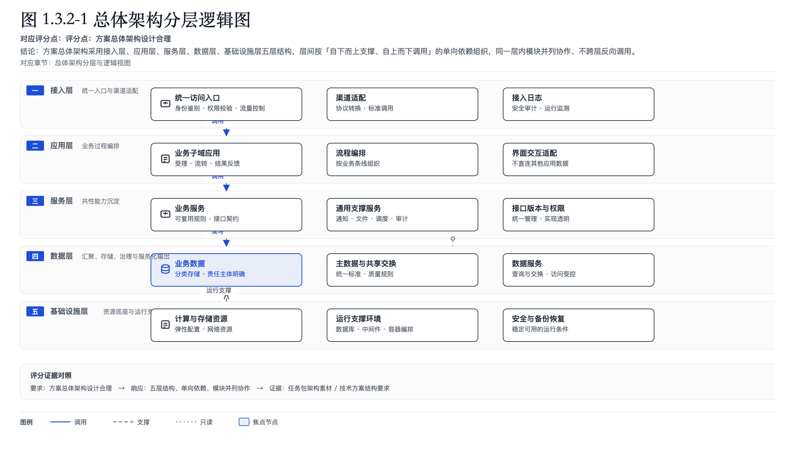
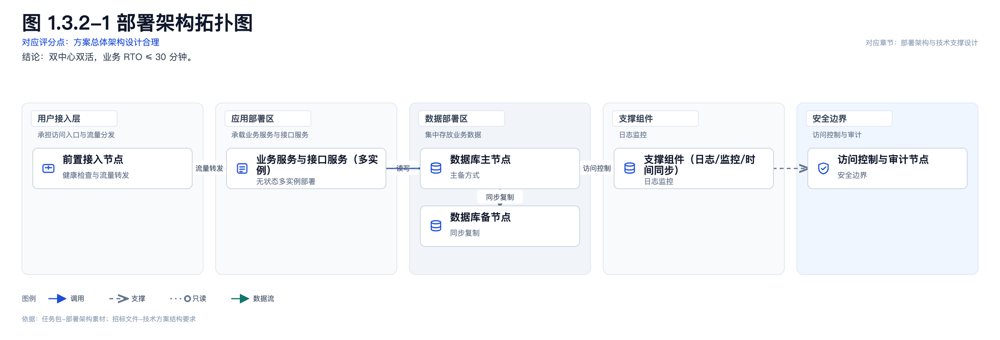

# 设计版生图：生产级适配深度分析

> 日期：2026-11-04
> 视角：产品经理 + 应标/评标专家
> 对象：当前「AI 生成图表（设计版）」链路（Diagram Design + LLM 直接生成 HTML/SVG + Playwright 渲染）
> 结论：**当前产物是“结构示意图”，不是“可直接进正式投标文件的生产级图”。问题不在某一根箭头，而在产品定位、图型体系、生成方式和视觉规范四层。**

---

## 0. 先看两个真实产物

当前真实章节产物（总体架构分层逻辑图）：



当前模块级连接产物：



优点：
- 分层、编号、图标、评分点、结论、证据区、图例都有了；
- 箭头有调用/支撑/只读区分；
- 中文、可打印、无外链。

但作为一个应标专家，我的第一反应仍然是：
> “这是一张示意图/概念图，不是实施交付图。我能看懂结构，但看不出这个方案真的能落地。”

---

## 1. 为什么“看起来还是示意图”

### 1.1 视觉语言是“编辑设计”，不是“投标方案”

当前技能的上游审美是 editorial minimal：白纸、细线、少色、强留白、几何图形。它适合官网/设计文档，不适合中文投标技术方案。

投标文件里的架构图通常需要：

- 明确的**系统边界/网络区域**；
- 真实产品/组件名称、版本、部署单元；
- 服务器、数据库、负载均衡、存储等**工程对象**；
- 高可用/容灾/安全/监控/运维的**可验证结构**；
- 接口协议、端口、数据流向；
- 图标、分区底色、图例、编号、图注；
- 在 A4 正文中缩放后仍然可读的信息密度。

当前图只有“层 + 白框 + 少量线”，没有这些工程语义，所以视觉上必然像草图。

### 1.2 图形元素只有“框、线、圆、图标”，没有“产品/部署/证据”

当前生成受限于：
- 不允许外链图片；
- 不允许嵌入真实产品截图；
- 模型只画 SVG 基本图元；
- 图标库只有 6 个通用图标（database/server/gateway/user/cloud/shield）。

因此它无法表达：
- 真实产品 UI；
- 物理部署节点；
- 网络边界与安全设备；
- 监控大屏/证书/资质；
- 方案截图和产品照片。

### 1.3 视觉密度和版式没有按 A4 投标页设计

当前图是“画布自适应”，不是“A4 页面版式”：
- 大留白、字号偏小、图例和证据区松散；
- 没有页边距、图号位置、图注规范、跨页规则；
- 插进 Word 后容易缩得太小，评审看不清；
- 没有统一的中文投标字体、字号、行距、色板。

### 1.4 箭头只是“关系符号”，不是“工程接口”

虽然现在有调用/支撑/只读，但：
- 箭头常常没有端口、协议、方向说明；
- 一条箭头跨多层，无法对应具体接口；
- 没有网络区域/安全域边界；
- 箭头标签是“调用/支撑”，不是“HTTPS 443 / JDBC / Kafka / 定时同步”。

评标专家要的是“接口关系可落地”，不是“箭头好看”。

---

## 2. 图片类型：当前是“视觉类型”，不是“投标交付物”

当前 12 类：架构、分层、流程、决策、时间线、目标分解、金字塔、矩阵、闭环、组织、数据流、现状对比。

问题：**这是设计图型分类，不是评标场景分类。**

真正用于投标技术方案的图，至少应分为：

| 交付物类型 | 评标用途 | 当前是否支持 |
|---|---|---|
| 逻辑架构图 | 证明分层合理、模块完整 | 部分支持，但偏概念 |
| 部署拓扑图 | 证明可落地、高可用、容灾 | **不支持** |
| 网络/安全拓扑图 | 证明等保、边界、隔离 | **不支持** |
| 数据架构图 | 证明数据流、主数据、数据治理 | 部分支持，但无数据对象 |
| 集成/接口关系图 | 证明系统能对接 | **弱** |
| 实施方案路线图/Gantt | 证明工期、阶段、交付 | 只有时间线，无任务/里程碑 |
| 评分点响应矩阵 | 证明逐条响应 | 只有矩阵图，不是响应表 |
| 运维/SLA 体系图 | 证明可持续运营 | **不支持** |
| 组织/RACI | 证明团队保障 | 只有组织图 |
| 现状-目标对比 | 证明改造价值 | 支持，但缺量化 |
| 产品界面截图/证据 | 证明产品真实存在 | **不支持** |
| 自主可控/信创适配清单 | 证明合规 | **不支持** |

**关键判断：**
- 逻辑架构、部署拓扑、安全拓扑、数据架构、实施路线、响应矩阵是“生产级图”；
- 流程、闭环、金字塔、矩阵更适合“概念说明图”；
- 产品截图/证书/监控大屏不是生成图，必须走真实素材上传/排版。

---

## 3. 结构合理性：自由生成 SVG 不可控

### 3.1 当前结构是“模型边想边画”

当前链路：

```
brief → LLM 直接写 HTML/SVG → 正则/self_check → 渲染
```

模型同时负责：
- 选图型；
- 分层；
- 布局；
- 节点位置；
- 箭头路径；
- 标签位置；
- 视觉样式。

这不是“生成图表”，这是“让模型即兴画图”。结果是：
- 箭头对应关系只能靠 prompt 约束，无法保证；
- 同一 brief 两次生成结构不同；
- 很难稳定插入正式文档；
- 无法做严格的结构校验。

### 3.2 缺少“视图分离”

一个系统至少需要四种视图，不能混在一张图里：

| 视图 | 回答的问题 | 例 |
|---|---|---|
| 逻辑架构 | 系统由哪些层/模块组成 | 接入/应用/服务/数据/基础设施 |
| 部署架构 | 部署在哪、怎么高可用 | 双中心、DMZ、K8s、数据库主备 |
| 数据架构 | 数据从哪来、怎么存、怎么用 | 源系统→湖→仓→服务 |
| 安全架构 | 边界在哪、怎么防护 | 等保三级、密评、堡垒机、WAF |

当前“架构图”把逻辑、部署、数据、安全揉在一起，评标专家看不出每张图回答什么问题。

### 3.3 缺少“事实绑定”

当前 brief 主要来自：
- 本节 points；
- 正文；
- plan basis ref。

但图里需要的：
- 模块清单；
- 产品名称/版本；
- 部署单元；
- 接口协议；
- 容量/并发；
- RTO/RPO；
- 标准条款；
- 资质/案例

并没有结构化输入。模型只能“合理推断”，于是出现：
- 空泛节点（接入层/服务层/数据层）；
- 通用箭头；
- 无来源数字；
- 图和正文对不上。

### 3.4 缺少“交付级校验”

当前校验能查：
- 是否有中文；
- 是否有 title/desc；
- 是否有 script/外链；
- 元素/数字/几何/箭头数量。

但查不了：
- 每个模块是否在本节正文/素材出现；
- 每条箭头是否对应真实接口；
- 层带是否语义正确；
- 部署是否符合高可用；
- 图是否能在一页 A4 内可读；
- 评标专家能否从图中找到评分点证据。

---

## 4. 产品定位需要重新切分

建议把“生图”拆成三条产品线，而不是一条自由生成链路：

### A. 生产级结构图（模板 + 结构化数据 + 确定性渲染）

适用：逻辑架构、部署拓扑、安全拓扑、数据架构、实施路线、响应矩阵。

做法：
- 定义 **结构化图模型**：

```json
{
  "view": "deployment",
  "zones": [{"id": "dmz", "label": "DMZ", "kind": "network"}],
  "nodes": [{"id": "lb", "label": "负载均衡", "kind": "lb", "tech": "F5", "evidence": "..."}],
  "edges": [{"from": "lb", "to": "app1", "kind": "https", "port": 443, "label": "HTTPS 443"}],
  "score_refs": ["..."],
  "evidence": ["..."]
}
```

- LLM 只负责**从正文/素材抽取结构化事实**；
- 渲染器负责布局、样式、连线、图例、图号；
- 同一模型输入输出稳定、可校验；
- 不再让模型即兴画 SVG。

这是生产级图的正确路线。

### B. 概念示意图（保留现有 Diagram Design）

适用：项目理解、现状-目标、业务流程、能力体系、汇报示意。

- 允许 editorial 风格；
- 明确标注“示意图”，不放进“生产级架构图”位置；
- 继续用现有 skill 生成。

### C. 真实证据图（上传/排版，不生成）

适用：产品截图、监控大屏、证书、案例照片、界面原型。

- 不能 AI 生成（会造假/失真）；
- 走素材上传、裁剪、图注、来源；
- 与评标证据绑定。

---

## 5. 重点图型重做建议

### 5.1 逻辑架构图（生产级）

必须有：
- 5–6 层，层内 2–5 个模块；
- 每模块：中文名 + 技术标签/职责；
- 层间关系：调用/支撑/数据流；
- 外部系统边界；
- 图例；
- 评分点/结论/证据；
- 模块与正文/素材可追溯。

视觉：浅灰层带、白卡片、品牌蓝主路径、图标、编号、A4 横向 10–12pt。

### 5.2 部署拓扑图（当前缺失，优先级最高）

必须有：
- 网络区域（互联网/DMZ/内网/管理区/备份区）；
- 节点（LB、Web、App、DB、Cache、MQ、存储）；
- 高可用（双机/集群/主备）；
- 容灾（同城/异地、RTO/RPO）；
- 安全设备（WAF、防火墙、堡垒机）；
- 端口/协议；
- 图例。

### 5.3 安全/等保拓扑图

- 边界、区域、设备、数据流、等保三级/密评要求映射；
- 不能只画“安全防护”一个框。

### 5.4 实施方案路线图

- 阶段、任务、里程碑、交付物、时间、责任方；
- 不是简单时间线；
- 最好表格+甘特结合。

### 5.5 评分点响应矩阵

- 评分点、要求、响应、证据、页码/章节；
- 这是评标专家最需要的图，但当前没有。

---

## 6. 视觉规范建议（投标正式版）

- 页面：A4 横向，安全边距 ≥24px；正文最小 10px（Word 中约 8–9pt 需复核）；
- 层带：浅灰/浅蓝底，左侧编号+层名；
- 卡片：白底、细边、顶部 2px 品牌色；
- 图标：统一图标库（服务器/数据库/网络/安全/用户/接口）；
- 颜色：黑/灰 + 品牌蓝 + 一个辅助色（安全/数据），最多 3 类语义色；
- 线型：实线调用、虚线支撑、点线只读；箭头端点必须落在组件；
- 图例：底部横条；
- 图号/图注/来源：图 x-x、对应评分点、依据；
- 黑白打印仍能区分层级；
- 一页一图，复杂系统拆多视图。

---

## 7. 质量门（生产级）

- 图中每个模块能在正文/素材找到依据；
- 每条箭头有源/目标/关系标签；
- 不允许悬空箭头、无端点箭头；
- 不允许未在 brief 出现的数字/产品/承诺；
- 层带语义正确（数据库不在服务层等）；
- 字在 100% 缩放下可读；
- 一张图只回答一个视图问题；
- 评审专家能在 10 秒内指出评分点、结论、证据。

---

## 8. 建议路线

### P0（1–2 周）
- 明确“示意图”和“生产图”两种模式；
- 先把现有链路定位为“示意图/概念图”；
- 选 1 个生产图型：**部署拓扑图**，做模板 + 结构化 JSON + 确定性渲染；
- 输入增加：区域、节点、部署单元、端口、HA/DR、证据。

### P1（2–4 周）
- 逻辑架构图、安全拓扑图、数据架构图模板；
- 评分点响应矩阵；
- 图型与评分点/素材绑定；
- 质量门和 A4 版式。

### P2
- 实施方案路线图/Gantt；
- 截图/证据图排版；
- 多视图联动（逻辑→部署→安全）。

---

## 9. 一句话结论

**当前方案的问题不是“箭头还不够好看”，而是“用自由生成的示意图去承担生产级技术方案图的任务”。**

正确方向：
- **概念图**继续用 Diagram Design；
- **生产图**改为“结构化事实 + 模板渲染 + 确定性布局 + 严格校验”；
- **证据图**使用真实截图/素材，不生成。

否则继续调 prompt，只会得到“更精致的示意图”，仍然不能直接用于正式投标。

---

## 10. P0 落地：生产级部署拓扑（确定性渲染）

按本分析先实现了第一个生产级模板：**部署拓扑图**。

- 输入：区域 / 节点 / 连接 + 评分点 / 结论 / 依据；
- LLM 只抽取结构化 spec，不画 SVG；
- `deployment_diagram.render_html()` 负责布局、图标、箭头、图例、图号；
- 同一 spec 渲染结果稳定；
- 接口：`POST /api/blocks/{id}/studio/deployment-diagrams`；复用 job/asset/PNG/Word 链路；
- 前端「插入… → 图片 → 生产级部署拓扑图」。

样例：



当前模板能力：
- 5 个网络/部署区域、6 个节点、5 条连接；
- 区域着色、节点图标、调用/支撑/数据流线型；
- 图号/评分点/结论/依据；
- 自动高度、短标签换行，避免文字越界。

仍待：
- 高可用/容灾节点（主备、双中心）的可视化语义；
- 端口/协议标签的自动避让；
- 区域超过 5 个时的自动分页/换行；
- 真实产品/截图证据槽位；
- 逻辑架构、安全拓扑、数据架构、实施路线等模板。
