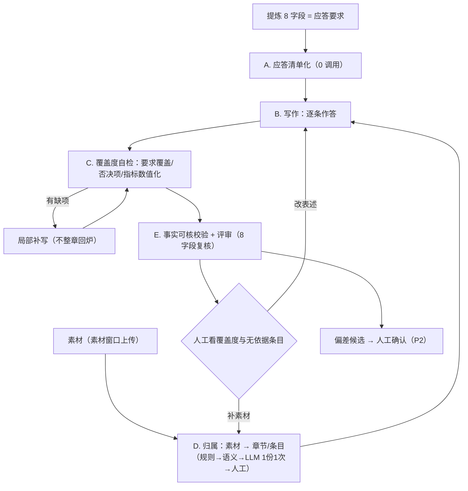

# 技术应答的写作与素材方案（v5 · 以"应答要求"为中心）

- 日期：2026-09-21
- 作者：江河（与 DSH 协作）
- **一句话结论**：满分来自"**逐条满足该章节的应答要求**"，不是来自"有没有素材"。
  提炼出来的 8 字段就是应答要求（含评分项/否决项/加分项/量化指标），**它才是中心**；
  素材是让响应更具体、更可核的**可选手段**；没素材也必须作答，只是要标注"无依据"。
  当前产品最大的漏洞不是匹配慢，而是**8 字段里只有 1 个进了写作输入，其余只在评审时用来扣分**。

---

## 0. 第一性原理：满分是怎么来的

```
评委按评分表逐项打分
   └─ 评分表落到每一章的形态 = 提炼出的 8 字段：
        requirement        本条要求（分点）
        key_points         逐条响应建议（= 该写什么）
        score_items        评分项与分值（= 分从哪来）
        veto_items         否决项（一票否决，必须显式响应）
        bonus_items        加分项（必须显式响应才能拿到）
        indicators         量化指标（必须数值化响应）
        evidence_required  证明材料
        constraint_level   强制等级（必须/应当/可选）
   └─ 所以写作的**目标函数** = 让这 8 项被逐条、显式、可核地回应
   └─ 素材的作用 = 让回应"更具体、更可信"（可信度影响评委给分），但**不是回应本身**
```

四条推论（v5 的全部逻辑都从这里来）：

1. **中心对象是"应答要求"，不是"素材"** —— 素材匹配是配角；先保证"要求被回应"，再谈"用素材把回应做实"。
2. **无素材也必须作答**：用通用技术表述/方法论写成"满足"的响应，但**标注"无依据"**、可信度低、供人工补强；
   **不阻断、不算缺料、不设为待办**（承接上一轮纠正）。
3. **必须做覆盖度自检**：写完要逐条核对"要求是否被回应"，否则"满足撰写要求"无从保证 —— 这一环现在完全缺失。
4. **素材的挂载点在"要求条目"**：一段素材支撑的是"本章第 2 条要求（并发 ≥2000）"，而不是"整个章节"。

---

## 1. 现状核实（证据带位置）

### 🔴 1.1 决定性漏洞：8 字段里只有 1 个进了写作输入

| 阶段 | 用到的字段 | 证据 |
|---|---|---|
| 提炼 | 8 个全产出 | `infra/llm/dispatcher.py:753-760` |
| **写作** | **只有 `requirement`**（+`constraint_level` 用于长度分档） | `dispatcher.py:584-587`：`extra_prompt = 【应标要求】requirement + 【参考素材】`；`:63-74` 仅用 constraint_level |
| 评审 | **8 个全给** | `agents/wang_anshi.py:234-240`、`agents/bao_zheng.py:235-241` |
| 工作台人工编辑 | 8 个可编辑 | 参考卡片 |

**后果**：`score_items`（评分项分值）、`veto_items`（否决项）、`bonus_items`（加分项）、`indicators`（量化指标）
写手全看不到 → 必然漏评分项、不显式响应否决项/加分项、指标不数值化 → **评审必扣分 → 协同闭环回炉**。
（闭环有迭代与收敛判定，`check_convergence` + `iteration` + 评审阈值，回炉成本会被轮次放大。）
一句话：**先让人在信息不全的情况下写，再拿全量规则扣分**。

### 🔴 1.2 素材原文从未进入正文

`agents/zhuge_liang.py:278` 把 rerank 的 `reason + hit_points` 当素材；`dispatcher.py:580` 再截 200 字；
`Match`/`_to_dict` 都没有 content（`infra/retrieval/rerank.py:25`、`orchestrator/nodes.py:1236`）。

### 🟠 1.3 无素材的章节被硬塞弱关联评语

生成 prompt 固定拼【参考素材】（`dispatcher.py:586`），哪怕匹配为空/弱相关，
内容还被 `[M]...[/M]` 标成"来自素材"（`:305`）→ 给自造内容盖章。

### 🟠 1.4 匹配方向是反的，且反向分配是死代码

现在逐章 `keyword_search(top_k=10)` + `llm_rerank`（`agents/shen_kuo.py:112-155`，调用数 = O(章节数)）；
而"素材 → 章节"的反向分配 `infra/retrieval/keyword.py:20` `assign_chunks_to_sections`
在 `routes/materials.py:34` 被 import，**全库无调用点**。

### 🟠 1.5 匹配池混入要求原文 / 全量重跑 / 界面无结果

`block_store.py:676` 无 role 过滤（实测要求类 83 段 / 素材类 63 段）；`runner.py:538` 每次清空全量重跑；
`project-init.html:2881` 只更新计数。

---

## 2. 正确模型（v5）

```
          ┌──────────────── 目标层：应答要求（8 字段 → 条目清单）────────────────┐
          │  每条：要求原文 · 类型(要求/评分/否决/加分/指标/证明) · 强制等级      │
          └───────────────────────────────┬────────────────────────────────────┘
                                          │  ① 必须逐条回应（无论有无素材）
                                          ▼
   ┌── 弹药层：素材（可选）──┐    ┌──────── 写作：逐条作答 ────────┐
   │ 素材 → 章节/条目归属     │──▶│ 满足 / 优于 / 偏差 + 依据       │
   │ （原文 + 出处 + 性质）   │    │ 有素材→引用原文；无素材→自撰+标注│
   └───────────────────────┘    └───────────────┬────────────────┘
                                                 │
                                                 ▼
                          ┌──── 验收层：覆盖度自检（逐条核对）────┐
                          │ 要求覆盖 100% · 否决项显式响应 100%   │
                          │ 指标数值化 · 评分项命中 · 依据可核     │
                          │ 缺项 → 局部补写（不整章回炉）          │
                          └──────────────────────────────────────┘
```

- **应答清单**：由 8 字段零成本展开（`requirement` 与 `key_points` 已是分点文本，直接切条；
  `score_items`/`veto_items`/`bonus_items`/`indicators` 各自成条）。
- **条目状态**：✅ 已响应（有依据） / ⬜ 已响应（无依据，标注） / ❌ 未响应（自检报错） / ⚠️ 偏差。
- **素材挂载在条目上**：一条素材可支撑多条；一条要求也可由多条素材支撑。
- **无素材章节正常写**：只是条目状态多为"已响应（无依据）"，用于人工决定要不要补强。

---

## 3. 产物与验收口径（第一性）

**主产物 = 章节应答清单 + 覆盖度报告**（每条要求：响应句 / 依据 / 状态）。

| 层级 | 指标 | 目标 |
|---|---|---|
| **一票否决级** | ① 要求覆盖率（每条都有明确回应） | **100%** |
| | ② 否决项显式响应率 | **100%** |
| | ③ 评分项命中率（`score_items` 每条都被回应） | 100% |
| **质量级** | ④ 量化指标数值化率（`indicators` 有具体值） | 100% |
| | ⑤ 依据可核率（正文数值可在素材中找到） | 100%（有素材时） |
| | ⑥ 加分项响应率 | 尽量 100% |
| **效率级** | ⑦ 一次通过率（不触发协同闭环回炉） | 越高越好 |
| | ⑧ 评审分数（王安石/包拯） | 不下降 |
| **辅助** | 素材支撑率（多少条响应有素材依据）、归属准确率、调用数 | 参考 |

> 素材相关指标**降级为辅助**：它影响可信度与打磨优先级，不决定"能不能写、能不能得分"。

---

## 4. 方案

### A. 应答清单化（零成本，立刻可做）

把 8 字段展开为条目（每章一张清单）：

```
条目 = {
  id, 章节id,
  类型: 要求 | 评分项 | 否决项 | 加分项 | 量化指标 | 证明材料,
  原文,                       # 字段原文（分点则拆条）
  强制等级,                   # constraint_level
  响应状态: ✅有据 | ⬜无据 | ❌未响应 | ⚠️偏差,
  响应句,                     # 生成/人工填写
  依据: [素材片段/卡片 + 出处] # 可为空
}
```

- 拆条规则：按行/分号/序号拆；`requirement` 与 `key_points` 已要求"分点列出"，天然可拆。
- 这一层不需要任何模型调用。

### B. 写作输入补齐（P0，单点收益最大）

`dispatch_block_write` 的 extra_prompt 从「要求 + 素材」扩成：

```
【本章应答要求】（逐条编号，来自提炼 8 字段）
  R1 …（requirement 第 1 条）
  S1 评分项：技术方案完整性 20 分
  V1 否决项：未提供 CMA 检测报告者投标无效
  B1 加分项：三年免费升级
  I1 量化指标：响应时间 ≤200ms
【响应建议】（key_points 逐条）
【素材原文 + 出处】（有则给；无则整段不出现）
【输出要求】逐条回应上面每一条；数值必须可核；不得遗漏否决项
```

- 这是**唯一一处改动就能显著提高一次通过率**的地方（评审不再"事后扣分"）。
- 同时修掉 1.3：无素材时不拼【参考素材】段。

### C. 覆盖度自检（新增环节，写作后立即执行）

- 轻量做法（推荐）：让生成阶段**按清单输出**（每条要求对应一段带编号的回应），自检 = 结构校验 + 1 次快速判定
  （"以下每条要求是否被正文回应？" 输入是清单 + 正文，输出缺失条目号）；
- 缺项 → **局部补写**（只补这一段），不整章回炉；
- 自检结果写进章节状态（覆盖度徽标），并在评审页展示。

### D. 素材匹配阶段（定稿设计）

**边界**：匹配阶段只回答「哪条要求的依据是什么、原文在哪、有没有」；**不写一个字**。
逐条作答、覆盖度自检、数值可核校验都属于撰写阶段。

#### D.1 输入（4 项）

1. **章节 + 应答要求条目**：8 字段展开成条目（零成本；条目是挂载点）
2. **素材片段**：只取**「素材」窗口上传件**；每段带 `原文 / 首行标题 / 文件名 / 段序 / 来源属性`
3. **招标文件侧的依据**：**不走切片匹配** —— 实测要求类文件在上传时不做切片
   （由工作流 parse 节点解析进 `spec.toc[].raw_content`），所以 `roles=spec/...` 的池子通常为空。
   招标原文与章节本来就是一一对应的：理解/背景类章节直接用**本章的 `raw_content`** 作为"招标原文依据"即可
   （`source_kind=tender`，只允许背景/条款引用）
4. **已有人工挂接**：锁定项不参与重算

> 已核实：素材类片段首行就是标题（`routes/materials.py:94` 写入 `f"{sec.title}\n{sec.raw_content}"`），
> 规则归属可直接用"片段首行 ↔ 章节标题"，**零调用**；scoring/evaluation 是按行细粒度切片（无标题），
> 这也再次说明它们适合当"评分上下文"而不是素材候选。

#### D.2 处理（四层，成本从低到高）

| 层 | 做什么 | 成本 |
|---|---|---|
| ① 规则/结构 | 片段首行标题 ↔ 章节标题（规范化 + 词重叠）；标准号/协议名/参数名+单位精确命中 | **0 调用** |
| ② 语义 | `assign_chunks_to_sections`（BM25 反向分配）：片段 ↔ 章节文本（title + requirement + key_points + indicators） | 0 调用 |
| ③ LLM 归属 | **一份素材一次调用**（已确认，不设分批上限）；只对规则/语义低置信的片段介入 | O(素材份数) |
| ④ 人工 | 素材侧/条目侧手动挂接、解绑（挂接即锁定） | — |

#### D.3 产物：**匹配阶段 → 撰写阶段的契约**（核心）

```jsonc
{
  "s2.3.1": {
    "items": [                                  // 来自提炼 8 字段（匹配阶段不改内容）
      { "item_id": "s2.3.1#R1", "type": "requirement", "text": "支持国产数据库…" },
      { "item_id": "s2.3.1#I1", "type": "indicator",   "text": "并发 ≥2000 用户" }
    ],
    "evidence": {                               // 条目 → 依据（P0 先做章节级，P1 细化到条目）
      "s2.3.1#R1": [
        { "chunk_id": 41, "content": "达梦 DM8…", "file": "产品规格书.pdf",
          "locator": "第 12 段",                 // P0：第 N 段；P1：页码/锚点
          "kind": "fact",                       // fact | solution | background
          "source_kind": "ours",                // ours | tender
          "by": "rule",                         // rule | semantic | model | human
          "confidence": 0.9 }
      ]
    },
    "chapter_level": []                         // 不针对具体条目的整章素材（可选）
  }
}
```

- **`content` 必须有**（原文）——当前 `Match` / `blocks.source` 都没有，这正是"最后一公里"缺口。
- 落库：`blocks.source` 升级为该结构（读写共用），前端与撰写阶段消费同一份数据。
- 无依据条目**只做信息呈现**（供撰写阶段与人工参考），不是待办、不阻断。

#### D.4 界面

```
┌ 素材（6 份）──────────────────┬ 章节 × 应答要求（33 章 / 165 条）────────────┐
│ 产品规格书.pdf   → 供 12 章 41 条 │ 2.3.1 数据层设计                      │
│   ├ 首行「数据层设计」→ 命中同章节 │  R1 支持国产数据库       依据 2 条 ↗   │
│ 架构方案.pptx    → 供 6 章 18 条  │  I1 并发 ≥2000 用户       依据 0 条     │
│ 接口文档.docx    → 供 4 章 9 条   │  V1 未提供检测报告即无效   依据 1 条 ↗   │
│ 招标文件.pdf     → 背景引用 9 章  │  [挂接素材 ▾] [解绑] [只看无依据条目]   │
│ [+ 上传素材]                     │ 顶部：有依据 128 条 / 无依据 37 条（信息）│
└─────────────────────────────────┴─────────────────────────────────────┘
按钮：「分析素材归属（预计 2 次调用）」　「只分析新上传的素材」
```

#### D.5 匹配阶段自己的验收指标

| 指标 | 目标 |
|---|---|
| 归属准确率（人工抽查"这段素材是否真属于该条要求"） | 核心质量 |
| **原文完整率**：evidence 带 `content` 的比例 | **100%** |
| 出处可溯率：带 `file + locator` 的比例 | 100% |
| 规则/语义命中占比（零调用比例） | 越高越好（≥60% 可行） |
| 调用数 | 正比于**素材份数**，与章节数解耦 |
| 增量正确性：补 1 份素材只重算该份 | 100% |

> 覆盖率、否决项响应率、指标数值化率属于**撰写阶段**验收，不在匹配阶段考核。

#### D.6 已确认的三条执行口径

1. **挂载粒度**：P0 先做**章节级**归属，P1 再细化到**条目级**
2. **出处精度**：P0 用「文件名 + 第 N 段」，P1 做到页码/锚点
3. **LLM 归属**：**一份素材一次调用**，不设分批上限


### E. 事实可核与偏差

- 事实性（参数/协议/标准号）：正文出现素材里查不到的数值 → 原地标 `[未核实：2000 并发]` + 评审告警；**不硬拒稿**（已确认）。
- 偏差：素材与要求冲突 → 生成"偏差候选"，人工确认后写入偏差说明（P2）。

### F. 交互

```
┌ 章节应答清单（2.3.1 数据层设计）───────────────┬ 素材（本条目可用）──────┐
│ 覆盖度 6/6 ✅  · 依据 4/6（2 条无依据）        │ 规格书 P12 达梦 DM8 ↗  │
│ ─────────────────────────────────────────────│ 架构方案 P8 分层设计 ↗ │
│ R1 支持国产数据库          ✅有据  [看响应]    │ [挂接素材][解绑]        │
│ I1 并发 ≥2000 用户         ⬜无据  [看响应]    │                        │
│ V1 未提供检测报告即无效     ✅有据  [看响应]    │                        │
│ S1 技术方案完整性 20 分     ❌未响应 [去补写]   │                        │
└───────────────────────────────────────────────┴────────────────────────┘
顶部：覆盖度 21/33 章达标 · 未响应条目 12 · 无依据条目 46（信息性，不阻断）
```

- 生成后自动刷新清单状态；缺项可一键"局部补写"。
- 素材行 → 章节/条目（"供 N 条要求"）；条目行 → 素材（"n 条依据"）。

### G. 度量

每轮记录：条目总数 / 覆盖数 / 未响应数 / 有据数 / 素材调用数 / 回炉轮次；
质量回归：同一标书"补齐 8 字段前后"各跑一次，比较**一次通过率与评审分数**（预期：问题数明显下降）。

---

## 5. 交互流程图

### 5.1 主流程（第一性版）

```
┌──────── 提炼（已完成）──────────────────────────────────────┐
│ 8 字段 = 本章应答要求（要求/评分项/否决项/加分项/指标/证明）  │
└───────────────────────┬────────────────────────────────────┘
                        ▼
┌──────── A. 应答清单化（0 调用）────────────────────────────┐
│ 8 字段 → 条目清单（类型 · 原文 · 强制等级 · 状态）           │
└───────────────────────┬────────────────────────────────────┘
                        ▼
┌──────── D. 素材归属（可选、并行）──────────────────────────┐
│ 素材 → 章节/条目（规则 → 语义 → LLM 1 份 1 次 → 人工挂接）   │
│ 产物：条目 ↔ 素材（原文 + 出处）                            │
└───────────────────────┬────────────────────────────────────┘
                        ▼
┌──────── B. 写作：逐条作答（P0 核心）───────────────────────┐
│ 输入 = 应答清单 + 响应建议 +（有素材才有的）素材原文 + 出处   │
│ 输出 = 逐条回应（满足/优于/偏差 + 依据）                     │
└───────────────────────┬────────────────────────────────────┘
                        ▼
┌──────── C. 覆盖度自检（新增）─────────────────────────────┐
│ 逐条核对：要求覆盖 100% · 否决项显式响应 · 指标数值化        │
│ 缺项 → 局部补写（不整章回炉）；结果写回清单状态              │
└───────────────────────┬────────────────────────────────────┘
                        ▼
┌──────── E. 事实可核 + 评审 ───────────────────────────────┐
│ 数值不可核 → 原地标注 + 评审告警                            │
│ 评审（王安石/包拯）拿 8 字段复核 → 问题显著减少（因为写前已给）│
└───────────────────────┬────────────────────────────────────┘
                        ▼
┌──────── 人工：看覆盖度与"无依据"条目 → 选择性补素材/改表述 ──┐
│ 补素材 → 只重分析新增素材 → 只更新其归属条目                 │
└──────────────────────────────────────────────────────────┘
```

### 5.2 Mermaid 版



---

## 6. 分阶段落地

### P0（当天～1 天，收益最大）

1. **写作输入补齐 8 字段**（§4.B）：一处改动，直接减少"评审扣分 → 回炉"；
   同时**无素材不拼【参考素材】段**。
2. **覆盖度自检**（§4.C）：逐条核对 + 缺项局部补写；结果写回章节状态。
3. **素材原文进正文**（§1.2）：片段带 content/出处，生成注入原文；`blocks.source` 同步带原文。

### P1（2–3 天）

4. **应答清单 UI**（条目级）+ 素材挂载到条目（§4.F）
5. **归属方向反转 + 增量**（接上 `assign_chunks_to_sections`；按素材粒度）
6. **事实可核校验 + 评审告警**（§4.E）

### P2（观察后定）

7. 偏差候选与确认（素材 vs 要求冲突）
8. 向量召回（方案性/背景性表述）
9. 归属准确率统计 → 反哺规则；一次通过率与评审分数回归看板

---

## 7. 结论与已确认决策

**结论**：方案的中心对象从"素材"改成"**应答要求**"。
- 素材匹配不再是主线，而是"给要求条目找依据"的辅助动作；
- 无素材的章节照常写，只是标注"无依据"；
- **真正决定满分的是"逐条覆盖 + 显式响应否决项/评分项/加分项 + 指标数值化"**，
  而这三件事所需的信息（8 字段）**现在只有 1 个进了写作输入** —— 这是首要修复项。

| # | 已确认 |
|---|---|
| 1 | 招标文件提炼出的内容是**该章节的应答要求**；无论有无素材，撰写内容都必须**满足这些要求**（这才拿得到分）。 |
| 2 | 素材是**可选的部分依据/内容**；没匹配到的章节正常撰写/生成，不阻断、不算缺料。 |
| 3 | 匹配方向 = **素材 → 章节**（进一步细化到"要求条目"）。 |
| 4 | 素材不止参数与协议：事实性 / 方案性 / 背景性，分别按可核 / 可引 / 可溯校验。 |
| 5 | 招标文件用途受限（可作背景与条款引用，不可充当"我方技术表述"）。 |
| 6 | 数值/协议/标准号不可核 → 原地标注 + 评审告警，不硬拒稿。 |
| 7 | 素材抽取范围 = 用户在「素材」窗口上传的内容。 |

---

## 8. 执行进度

| 项 | 状态 | 证据 |
|---|---|---|
| 匹配阶段设计定稿（输入/处理/契约/界面/验收 + 三条执行口径） | ✅ | 本文件 §4.D |
| **契约模型 `MaterialEvidence`**（原文/出处/性质/来源/归属方式/置信度） | ✅ | `domain/material/models.py`，round-trip 测试 |
| **归属引擎**：规则（首行标题 ↔ 章节标题）+ 语义（BM25 反向分配）+ 阈值 + 招标用途受限 + 统计 | ✅ | `infra/retrieval/assign.py`；`tests/infra/test_assign.py` 14 条 |
| **素材池分池**：`list_chunks_with_filename(roles=…)` + `material_role` 回传 | ✅ | `services/block_store.py`；`OURS_/TENDER_MATERIAL_ROLES` |
| 节点接线：`shen_kuo_match_node` 改走归属（`MATCH_MODE="assign"`，旧 rerank 路径保留回滚） | ✅ | `nodes.py`；`_match_by_assignment()` + 3 条节点测试 |
| **根因修复**：匹配池**从库里按来源分池取**（此前标准流程从不填 `materials.chunks`，节点走空池短路：每章空匹配、零调用，界面却显示"33/33 已完成"） | ✅ | `nodes.py`；`test_shen_kuo_match_node_loads_pool_from_db` |
| `Match`/`blocks.source` 升级为契约（带原文/出处/性质/来源） | ✅ | `rerank.py` + `_match_to_dict/_dict_to_match` |
| 撰写阶段注入**素材原文**（不再注入 rerank 评语） | ✅ | `zhuge_liang.py`；`MATERIAL_SNIPPET_CHARS=600` |
| `rerun_match` 增量（默认不清空；`full=true` 才全量） | ✅ | `runner.rerun_match(full=)` + 路由 + `api.js` |
| **条目级挂载**：8 字段展开成应答条目（`R/K/V/B/S/E/I`）+ 素材挂到条目（`item_ids`） | ✅ | `domain/spec/response_items.py`；`assign.mount_items`；`GET /projects/{id}/response-items` |
| **出处精度升级**：`P12 · 第 8 段 · 切片标题`（页码来自 PDF/Word 解析，落在 `material_chunks.page`） | ✅ | `assign.build_locator`；`db.py` 迁移 + `_parse_and_chunk` 写 page |
| **界面：双向素材视图**（素材「供 N 章 · M 条」/ 章节按**条目**列依据：原文摘要 + 出处 + 性质徽标） | ✅ | `workspace-model.mjs` 的 `evidenceBySource/usageFor/renderEvidenceSection`（node --test 12 条）；`project-init.html` |
| LLM 归属（1 份素材 1 次调用） | ⏳ P2 | 规则+语义已覆盖（实测零调用 100%），留作语义层补召回 |
| 人工挂接 / 解绑（写 `blocks.source`） | ⏳ P1 可选 | §4.D.4 里的 `[挂接素材][解绑]`，未做 |

**端到端实测**（隔离后端，11 章目录 + 2 份 source 素材）：
- 第 1 次匹配：`归属完成 {total_chunks: 16, assigned: 11, by_rule: 3, by_semantic: 8, unassigned: 5}`，**`llm_usage` 全程 0 行**（rerank/match 各 0）
- `blocks.source` 抽样带全契约字段：`content`（原文）+ `filename` + `locator=第 N 段` + `kind=fact/solution/background` + `source_kind=ours` + `by=rule/semantic` + `confidence`
- 补第 2 份素材后再匹配：池子 32 条 → **只处理 21 条新增**，旧素材的 11 条依据原样保留，新素材新增 11 条；仍然 0 次模型调用

**② ③ 落地后的实测**（真实项目 3：69 章 / 643 条应答条目 / 37 段素材，隔离只读复算）：
- 归属：37 段素材 → 37 条依据（规则 3 / 语义 34 / 未归属 0），**零模型调用**
- 条目级挂载：**22/37（59%）** 挂到具体条目，其中 17 条只挂 1 个条目（"只保留最高分那一档"生效）
- 长条目必须走**子句**打分：整条比对只挂上 8/37（分母是整条要求的全部词），按实质子句 22/37。
  抽查 top 命中可解释："数据安全管理" ← 数据安全治理方案、"销毁等全生命周期保护方案" ← 客户信息全生命周期闭环管控
- 出处带页码：新上传素材产出 `P3 · 第 8 段 · 7 服务团队 项目负责人`；老数据（迁移前入库）无 `page`，退化为「第 N 段 · 切片标题」

**已落地的关键行为**（`tests/infra/test_assign.py`）：
- 「技术评分表」**不会**靠单个共同词"技术"挂到「技术架构设计」（规则层要求 ≥2 个共同词或完整包含）
- 招标片段**只能**挂到"理解/背景"类章节（`allows_tender_evidence`），方案/架构/指标章节必须由我方素材支撑
- 无关片段（食堂管理 / 公司简介）得分 0 → **不归属**（宁缺毋滥，不再给每章硬塞 5 段弱关联）
- 阈值实测标定：无关 0.0 / 同主题 0.9–1.8 → `DEFAULT_MIN_SEMANTIC_SCORE = 0.5`
- evidence 带原文 + `第 N 段` 出处 + 性质 + 来源，且 **JSON 可序列化**（BM25 的 numpy 分数已转 float）
